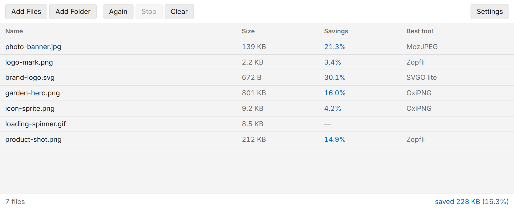
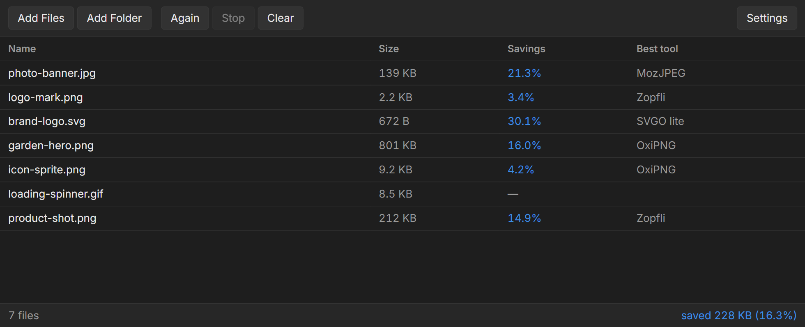
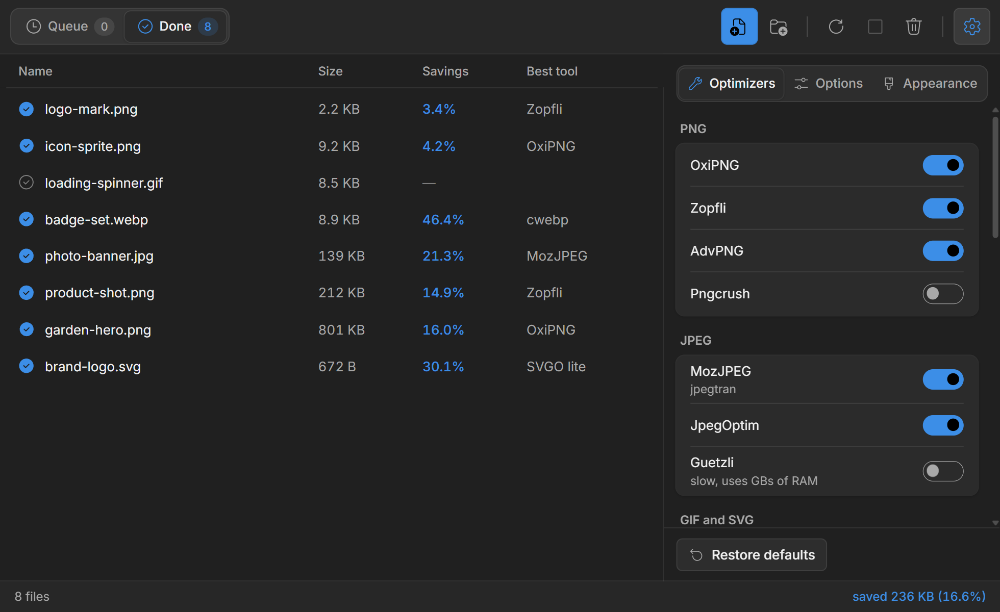

# ImageOptim

[ImageOptim](https://imageoptim.com) is a GUI for lossless image optimization tools: Zopfli, PNGOUT, [OxiPNG](https://lib.rs/crates/oxipng), AdvPNG, PNGCrush, [JPEGOptim](https://github.com/tjko/jpegoptim), Jpegtran, [Guetzli](https://github.com/google/guetzli), [Gifsicle](https://kornel.ski/lossygif), [SVGO](https://github.com/svg/svgo), [svgcleaner](https://github.com/RazrFalcon/svgcleaner) and [MozJPEG](https://github.com/mozilla/mozjpeg).

This repository is [ImageOptim](https://github.com/ImageOptim/ImageOptim) by
Kornel Lesiński and contributors, with a **Windows port** added. The macOS app's
window is Cocoa and does not translate, but every optimizer it drives is
portable, so `win/` contains a replacement front-end that runs them with the
same per-format plans and the same command-line arguments.

---

## ImageOptim for Windows

Drop files or folders in; each image is optimized in place and the smallest
result of every applicable optimizer is kept.



Light and dark follow the system setting.



Settings turns individual optimizers on and off, controls lossy quality per
format, sets the accent colour, and lists which optimizers are actually
installed.



### Download

From [Releases](https://github.com/carlhauser/imageoptim-windows/releases),
either `ImageOptim-Setup-<version>.exe` to install, or
`ImageOptim-<version>-win.zip` to unzip anywhere and run `ImageOptim.exe` with
nothing installed.

Both are built on a Windows machine in CI, with every optimizer compiled from
the sources in this repository.

The installed app updates itself: it checks for a newer release shortly after
starting (or on **Help → Check for Updates…**), downloads it in the background
and offers to restart. The zip copy can't replace its own files, so it only says
that a new version is out; unzip the newer zip in place of the old one. Versions
up to 1.4.2 don't check yet, so install the next one by hand once.

The app is not code-signed, so Windows shows a blue "Windows protected your PC"
box on first launch — **More info** → **Run anyway**. Unblocking the zip before
extracting avoids it.

**Files are replaced in place.** Saving is atomic — the result is staged beside
the original and renamed onto it — and each original is backed up for the session
so Ctrl+Z can restore it, but keep copies of anything irreplaceable.

### Building it yourself

`build-windows.ps1` compiles the optimizers from the sources in this repository
with MinGW-w64 under MSYS2, and `win/` packages the app around them. See
[`win/README.md`](win/README.md) for the detail, including how the optimizer
plans and the Zopfli size threshold were derived.

The screenshots above were taken on Windows 11 from a real run, and were
themselves optimized by this build: 39.1% smaller, Zopfli winning all three.

---

## Building the macOS app

Requires:

* Xcode
* [Rust](https://rust-lang.org/) installed via [rustup](https://www.rustup.rs/) (not Homebrew).

```sh
git clone https://github.com/carlhauser/imageoptim-windows.git ImageOptim
cd ImageOptim
```

The optimizers' sources are included in the repository rather than as git
submodules, so there is nothing more to fetch.

To get started, open `imageoptim/ImageOptim.xcodeproj`. It will automatically build all subprojects when run in Xcode.

In case of build errors, this sometimes helps:

```sh
cd gifsicle # or pngquant
make clean
make
```
