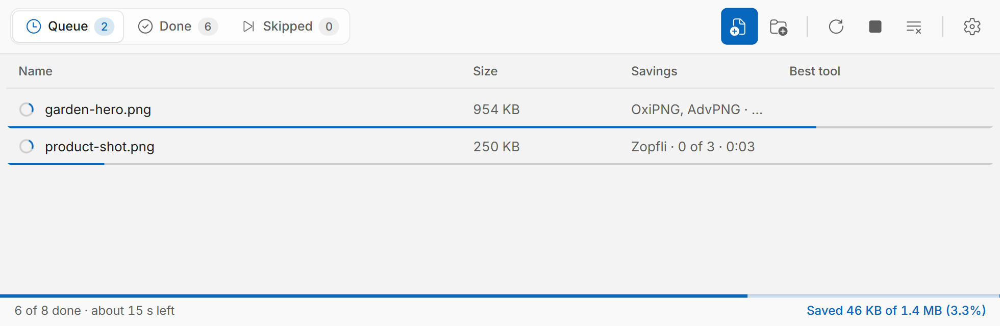
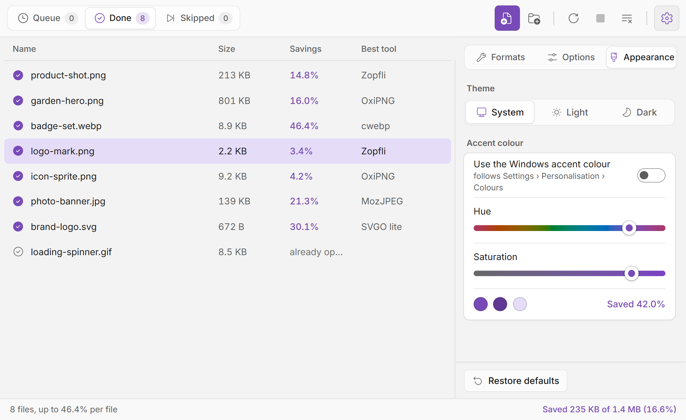

# ImageOptim

[ImageOptim](https://imageoptim.com) is a GUI for lossless image optimization tools: Zopfli, PNGOUT, [OxiPNG](https://lib.rs/crates/oxipng), AdvPNG, PNGCrush, [JPEGOptim](https://github.com/tjko/jpegoptim), Jpegtran, [Guetzli](https://github.com/google/guetzli), [Gifsicle](https://kornel.ski/lossygif), [SVGO](https://github.com/svg/svgo), [svgcleaner](https://github.com/RazrFalcon/svgcleaner) and [MozJPEG](https://github.com/mozilla/mozjpeg).

This repository is [ImageOptim](https://github.com/ImageOptim/ImageOptim) by
Kornel Lesiński and contributors, with a **Windows port** added. The macOS app's
window is Cocoa and does not translate, but every optimizer it drives is
portable, so `win/` contains a replacement front-end that runs them with the
same per-format plans and the same command-line arguments.

---

## ImageOptim for Windows

Drop files or folders in; each image is optimized in place and the smallest
result of every applicable optimizer is kept. It takes PNG, JPEG, GIF and SVG
like the macOS app, and WebP and AVIF as well: lossless WebP is recompressed
losslessly with cwebp and EXIF and XMP are stripped, and with lossy
minification on, lossy WebP and AVIF are re-encoded (cwebp, avifenc) when that
saves at least 5%. One bar runs along the top: the
**Queue**, **Done** and **Skipped** tabs on the left, the commands as icons on
the right. Files waiting or being optimized are under Queue; each one moves to
Done as it finishes, and the window switches to Done when the queue runs out.

While files are queued, a bar at the bottom of the window and the taskbar
button fill up, and the status bar shows how many are done and about how long
is left. The time is learned from the files as they finish. Files an earlier
run already optimized, in this session or a past one, are recognised by their
content and go straight to Skipped, left as they are.

A running file says which optimizer is at work and for how long. A file that
could not be optimized says why, in words, and the status bar counts the
failures. Right-click a file, or select several, to open it, show it in
Explorer, copy its path, optimize it again, stop it, restore the original or
take it off the list; the column headings sort, and Ctrl+F filters. It stays
quick with tens of thousands of files, and works with the keyboard alone, with
a screen reader and in Windows' contrast themes.




Light and dark follow the system setting, or can be fixed under Settings →
Appearance.


Settings has three tabs:
- **Formats** has a card for each format: its optimizers, whether its
  metadata is stripped and, with lossy minification on, its quality. It also
  shows which optimizers are installed.
- **Options** has:
  - lossy minification;
  - **Keep originals**;
  - whether to skip files already optimized;
  - the queue order and how hard to work.


**Appearance** picks the theme and the accent colour: Windows' own, or a hue
and a saturation slider that every shade in the window follows, here set to
purple.



The window adapts as it narrows: the tabs keep their icons and counts, the list
drops the less important columns, and settings slide over the list.

### Download

From [Releases](https://github.com/carlhauser/imageoptim-windows/releases),
either `ImageOptim-Setup-<version>.exe` to install, or
`ImageOptim-<version>-win.zip` to unzip anywhere and run `ImageOptim.exe` with
nothing installed.

Both are built on a Windows machine in CI, with every optimizer compiled from
the sources in this repository.

The installed app updates itself: it checks for a newer release shortly after
starting (or on **Help → Check for Updates…**), downloads it in the background
and offers to restart. The zip copy can't replace its own files, so it only says
that a new version is out; unzip the newer zip in place of the old one.

The app is not code-signed, so Windows shows a blue "Windows protected your PC"
box on first launch — **More info** → **Run anyway**. Unblocking the zip before
extracting avoids it.

**Files are replaced in place.** Saving is atomic: the result is staged beside
the original and renamed onto it. Each original is backed up for the session,
so Ctrl+Z can restore it.

To keep the originals for good, turn on **Keep originals** in Settings →
Options. Before a file is first changed, its untouched copy goes into an
`ImageOptim originals` folder beside it. That folder is never optimized, and
nothing in it is ever deleted.

### Building it yourself

`build-windows.ps1` compiles the optimizers from the sources in this repository
with MinGW-w64 under MSYS2, and `win/` packages the app around them. See
[`win/README.md`](win/README.md) for the detail, including how the optimizer
plans and the Zopfli size threshold were derived.

The screenshots above were taken on Windows 11 from a real run, and were
themselves optimized by this build: 37.3% smaller, Zopfli winning all five.

---

## Building the macOS app

Requires:

* Xcode
* [Rust](https://rust-lang.org/) installed via [rustup](https://www.rustup.rs/) (not Homebrew).

```sh
git clone https://github.com/carlhauser/imageoptim-windows.git ImageOptim
cd ImageOptim
```

The optimizers' sources are included in the repository rather than as git
submodules, so there is nothing more to fetch.

To get started, open `imageoptim/ImageOptim.xcodeproj`. It will automatically build all subprojects when run in Xcode.

In case of build errors, this sometimes helps:

```sh
cd gifsicle # or pngquant
make clean
make
```
