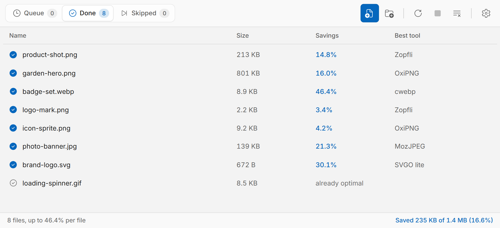

# ImageOptim for Windows

A Windows front-end for the optimizers that ImageOptim drives, plus a script that
builds those optimizers with MinGW-w64.

The macOS app is Cocoa and does not port, but every optimizer it runs is portable
C, C++, Rust or JavaScript. This directory holds an Electron app that queues
images, runs the same optimizers with the same command lines, keeps whichever
output is smallest, and overwrites the original in place.



## Building

### 1. The optimizer executables

Run from a PowerShell prompt at the repository root, on Windows:

```powershell
.\build-windows.ps1
```

It needs [MSYS2](https://www.msys2.org/) (`winget install -e --id MSYS2.MSYS2`),
installs the MinGW-w64 toolchain, CMake, Ninja, NASM, Perl, zlib, libpng and
gflags through `pacman`, and writes the results to `win\resources\bin`.

Rust comes from `rustup` when it is on PATH, otherwise from the MSYS2 package.
Either way the Rust tools are built for `x86_64-pc-windows-gnu`, so the whole
`bin` directory shares one ABI.

Useful flags:

```powershell
.\build-windows.ps1 -Only oxipng,pngquant -SkipBootstrap
```

```powershell
.\build-windows.ps1 -Clean -Jobs 8
```

A tool that fails to build is reported in the summary and the script carries on;
the front-end skips optimizers whose executable is absent, so a partial build
still runs with fewer optimizers.

#### WebP and AVIF codecs

The script also builds `cwebp.exe` and `webpmux.exe` from libwebp, and
`avifenc.exe` and `avifdec.exe` from libavif. libavif uses AOM for both encoding
and decoding and links the libpng and MozJPEG built above. What the app does
with them is under [WebP and AVIF](#webp-and-avif).

```powershell
.\build-windows.ps1 -Only libwebp,aom,libavif -SkipBootstrap
```

Their sources are plain directories at the repository root, like the other
optimizers, trimmed to what this build compiles:

| directory | release | source |
| --- | --- | --- |
| `libwebp/` | 1.6.0 | `libwebp-1.6.0.tar.gz` from `storage.googleapis.com/downloads.webmproject.org/releases/webp/` |
| `aom/` | 3.15.3 | `libaom-3.15.3.tar.gz` from `storage.googleapis.com/aom-releases/` |
| `libavif/` | 1.4.2 | tag `v1.4.2` of `github.com/AOMediaCodec/libavif` |

Removed from all three: tests and test data, documentation, the autotools,
Android, Gradle, JavaScript and SWIG builds, and editor and CI configuration.
Also libwebp's extras and sample image; AOM's apps, examples and tools, its Arm,
PowerPC and RISC-V SIMD code, and the third-party libraries only those use
(googletest, libyuv, libwebm, highway); and libavif's examples and Android
bindings. libwebp keeps `configure.ac`, which its CMake reads the version from,
and AOM keeps the `.cmake` files in `test/`, which its CMakeLists includes.
Nothing that was kept has been edited, so an update is the new release unpacked
with the same parts removed.

Things about this build that the flags alone do not explain:

- **cwebp is built without WIC.** With the Windows Imaging Component compiled
  in, cwebp decodes every input through it first, WebP included. The result then
  depends on which WebP codec the PC happens to have (most Windows 11 machines
  have the Store's WebP Image Extensions), and WIC returns the ICC profile and
  nothing else, so `-metadata all` silently dropped EXIF and XMP. libwebp's own
  reader carries ICC, EXIF and XMP over byte for byte. The PNG, JPEG, TIFF and
  GIF readers are off too; cwebp is only ever given WebP.
- **libavif's configure step would download libargparse.** It sets up
  `avifgainmaputil` along with the apps, and that tool links libargparse, which
  CMake fetches from GitHub. Only the `avifenc` and `avifdec` targets are built,
  so the script points FetchContent at an empty stand-in in
  `.build-win\libavif-no-argparse` and disconnects it, which keeps the build
  offline.
- **`AOM_TARGET_CPU=x86_64` is named, not detected.** AOM reads the CPU from
  `CMAKE_SYSTEM_PROCESSOR`, which CMake takes from `PROCESSOR_ARCHITECTURE`. A
  MinGW shell started from Git Bash rather than PowerShell does not have that
  variable, and AOM then quietly builds its generic C target with no SIMD.
- **AOM is reused.** It is the biggest compile here: just under two minutes with
  `-Jobs 4` on a 16-core desktop, and more on CI's four-core runner.
  `.build-win\aom-prefix` holds a stamp made of the configure flags and a hash
  of every file in `aom\`, and a later run links the library there for as long
  as the stamp matches. `-Clean` rebuilds it.

Every one of the four executables passes `Test-SelfContained`: each imports only
Windows' own DLLs. avifenc and avifdec are about 12 MB each, nearly all of it
AOM, since each carries both its encoder and decoder.

### 2. The application

```powershell
cd win
npm install
npm start
```

To produce an installer and a portable zip in `win\dist`:

```powershell
npm run dist:win
```

That writes `ImageOptim-Setup-<version>.exe`, its `.blockmap`, `latest.yml` and
`ImageOptim-<version>-win.zip`. It never publishes anything: releases are made
by CI from a version tag, as described under [Releasing](#releasing).

`extraResources` copies `win\resources` into the packaged app, so the installer
carries the executables built in step 1.

## What runs on which format

The plan for each image is a port of `doEnqueueWorkersInCPUQueue` in
`imageoptim/Backend/Job.m`, and the command lines come from
`imageoptim/Backend/Workers/*.m`.

| Format | Optimizers |
| ------ | ---------- |
| PNG | pngquant (lossy), Pngcrush, OxiPNG, AdvPNG, Zopfli |
| JPEG | Guetzli (lossy), JpegOptim, MozJPEG (jpegtran) |
| GIF | Gifsicle, Giflossy (lossy) |
| SVG | SVGO, Svgcleaner |
| WebP | webpmux (strips EXIF and XMP), cwebp (lossless, or a lossy re-encode) |
| AVIF | avifenc (lossy re-encode only) |

Optimizers that rewrite an image rather than merely recompressing it run first
and one at a time, so the rest see their output. The lossless ones then run in
parallel against that result, and the smallest output wins. A file that no tool
improved is left exactly as it was.

### WebP and AVIF

The macOS app handles neither, so these are this port's own, built on libwebp
and libavif (see [WebP and AVIF codecs](#webp-and-avif-codecs)):

* **A lossless WebP** is recompressed by `cwebp -lossless -z 9 -exact`, which
  keeps every pixel, the colour under transparent ones included. It stays
  lossless with lossy minification on: it is usually a graphic, where artefacts
  show. Above 2 MB it gets `-z 7`: on a 12-megapixel photo `-z 9` took 22 s and
  saved nothing.
* **A lossy WebP** can only shrink by being re-encoded, so with lossy
  minification off it only loses its metadata. With it on, cwebp re-encodes it
  at **WebP quality** (default 75) with `-m 6`.
* **An AVIF** has no lossless optimizer, so it is touched only with lossy
  minification on. avifdec decodes it to a 16-bit PNG and avifenc encodes that
  at **AVIF quality** (default 60), speed 6, or 4 at effort level 6 and up.
  PNG rather than y4m in between, because PNG carries the ICC profile, EXIF,
  XMP, alpha and the colour primaries and transfer, and avifdec applies any
  rotation, mirroring and crop to the pixels as it writes. What PNG cannot
  carry is passed along: the chroma subsampling and bit depth (or a 4:2:0
  10-bit photo would come back 4:4:4 and 12-bit) and HDR light levels.
* **Metadata:** EXIF and XMP are stripped from both (Strip metadata from WebP
  and AVIF, on by default); the ICC profile always stays. webpmux strips EXIF
  and XMP in two runs, since it takes one `-strip` at a time and fails on a
  chunk that is not there.
* **A lossy re-encode has to save at least 5%** over the file it was given, as
  jpegoptim's lossy pass does, measured after the metadata is gone. Otherwise
  the loss isn't worth it, and Optimize Again would re-encode the same file
  over and over for a percent each time.
* **Left alone:** animated WebP and AVIF (cwebp cannot decode an animation;
  avifdec writes only its first frame), AVIF with an HDR gain map (it would be
  lost), and AVIF of more than 12 bits. Such a row says why in the Savings
  column, with the full reason in its tooltip, and is not remembered as
  optimized, so turning lossy minification on later still works on it.

The defaults come from a test over 22 WebP and 22 AVIF files made from the
repository's sample images, of the kinds found on the web, with PSNR measured
against the file as it was given:

| | saved | PSNR |
| --- | --- | --- |
| lossless WebP, `-z 9` | 12.0% | identical |
| lossy WebP, metadata stripped only | 10.7% | identical |
| lossy WebP at 75 | 25.8% | 36-45 dB |
| lossy WebP at 80 | 15.4% | 42-53 dB |
| AVIF at 50 | 30.2% | 30-39 dB on photos: visibly worse |
| AVIF at 60 | 12.7% | 41-50 dB |
| AVIF at 60, speed 4 | 17.0% | the same, four times slower |

## Performance

Zopfli dominates the cost of a PNG run and, on anything photographic, loses to
OxiPNG anyway. Measured on this machine, one 2 MB PNG:

| optimizer | result | time |
| --------- | ------ | ---- |
| OxiPNG `-o4` | 1,354,628 B | 3.2s |
| Zopfli, 1 iteration | 1,428,213 B | 42.6s |
| Zopfli, 10 iterations | 1,389,170 B | 55.7s |

OxiPNG won at every size tested from 177 KB to 2 MB, between twenty and sixty
times faster. Capping Zopfli's `--timelimit` does not help, because it only
checks the clock between iterations and a single iteration on a large image
already overruns any sensible budget.

So `ZopfliSkipAboveKB` (default 256) skips Zopfli once a file is bigger than
that, which is ImageOptim's own threshold for a "large" PNG. Below it Zopfli is
cheap and does sometimes win, so it still runs. Over thirty photos:

| | time | saved |
| --- | --- | --- |
| default | 9.8s | 28.27% |
| `ThoroughPng: true` | 127.8s | 28.27% |

Thirteen times faster for 714 bytes out of 8.7 MB. `ThoroughPng` restores the
macOS behaviour exactly: no size threshold and no time budget.

`QueueOrder` decides which file is picked up next: `smallest` (the default) so
the list fills with finished rows quickly rather than appearing stuck on one
large image, `largest` so the slowest file is not left running alone at the end,
or `added` to keep drop order. Only files that have not started are reordered.

`MaxWorkers` caps how many optimizer processes run at once across every file.
Without a global cap the two limits multiply - files in flight times optimizers
per file - and oversubscribe the machine. Measured over thirty photos on a
16-core machine: 2 workers 27.0s, 4 workers 15.0s, 8 workers 12.0s, 16 workers
12.6s. The default is the core count capped at eight; it is only saved once
someone picks a number, so a settings file moved to another PC does not carry
this one's core count.

OxiPNG, pngquant, cwebp, avifenc and avifdec each start a thread per core
unless told otherwise, so eight of them at once ran several times as many
threads as the PC has. `lib/semaphore.js` hands each tool, as it starts, the
cores divided among the slots in use (or among all slots while files are
waiting): `-t` for OxiPNG, `-j` for avifenc and avifdec, `RAYON_NUM_THREADS`
for OxiPNG and pngquant, and cwebp's `-mt` only with more than one. The last
file of a batch gets every core. avifenc's `--autotiling` is left off, since
tiles cost size. Every optimizer runs at below-normal priority, as the macOS
app's RunLowPriority did, so the PC stays usable.

With fewer files in hand than slots, a step that goes first only because it
rewrites the file - Zopfli, a lossy JpegOptim pass, Pngcrush stripping - races
the others on the same input instead, as `Job.m` does; pngquant still feeds
the others, and webpmux still strips before a lossy re-encode is measured.
Guetzli runs one at a time across every file, waiting for its turn before it
takes a slot.

SVGO runs in Electron utility processes that load the bundle once and are
handed one file after another: the first file took 104 ms including starting
the process, each one after it 1 ms, against 100-300 ms for the whole Electron
process that used to be started per SVG.

The window stays responsive with tens of thousands of files. Measured with
20,000 small PNGs dropped as one folder, before and after the changes that
made it so:

| | before | after |
| --- | --- | --- |
| the list appears | 263 s | 4.6 s |
| a round trip to the main process while files run | 93 ms, up to 1.2 s | 3 ms, up to 90 ms |
| Stop | 37 s | 0.6 s |
| Clear | 30 s | 0.9 s |

Changed files go to the window in batches, at most ten times a second, with
the totals; the window keeps them in a model and draws only the rows in sight;
a folder is scanned by its entries' own types, with sizes and resolved paths
fetched a few dozen at a time; and the list of optimized files is appended
once a second rather than after every file.

`scripts/bench.mjs` measures the optimizers on a folder of images: bytes saved,
time and wins per tool, and the current PNG plan against OxiPNG's own Zopfli.
Over the realistic images in this repository - 33 screenshots, icons, photos,
GIFs and WebPs - OxiPNG with `-o max -Z` saved 0.3 KB on the PNGs Zopfli runs
on, against 6.8 KB for Zopfli followed by OxiPNG and AdvPNG, and took longer,
so the plan stays. Most of those images were optimized already; the interlaced
Gifsicle pass won none of three GIFs, too few to drop it on. The script is
there for larger, real image sets.

```sh
cd win && node scripts/bench.mjs <folder>
```

## Tests

```sh
cd win && npm test
```

No dependencies: `node:test` with the optimizers stubbed, so nothing is spawned.

`test/arguments.test.js` is the one that matters most. Every optimizer's command
line is asserted against the macOS worker it was ported from, with the
expectations taken from `imageoptim/Backend/Workers/*.m` rather than from
`lib/tools.js`, so a drift in the port fails rather than being blessed. A wrong
flag does not raise an error anywhere: the tool exits non-zero, the job reads
that as "no improvement", and a broken optimizer is indistinguishable from an
already-optimal file.

`test/plan.test.js` covers which optimizers each format gets and in which group,
`test/queue.test.js` covers folder scanning and queue order, and
`test/job.test.js` covers the parts that can destroy a file: adopting a result,
the atomic replace, the staleness refusals and revert. `test/filetype.test.js`
covers telling the formats apart, HEIC from AVIF included, and reading what a
WebP or AVIF file holds. The repository has no WebP or AVIF images of its own,
so `test/fixtures/` has three small ones, made from its sample images, for the
binary checks below.

`test/updater.test.js` drives the update logic against a fake electron-updater,
so it needs neither the network nor the package installed: telling an install
from the unzipped copy, never restarting while the queue is busy, which checks
stay silent, the banner's wording, and the `package.json` settings the release
path depends on (a draft release or an installer name with a space in it would
each break updating without failing anything else).

Stubbed tests cannot prove the optimizers *accept* those arguments.
`test/binaries.test.js` does, by running the real executables; it is skipped
unless a directory of them is given:

```sh
cd win && IMAGEOPTIM_BIN=/path/to/bin npm test
```

`binaries.test.js` also runs every optimizer on a path longer than 260
characters with Chinese and an emoji in it, and checks that what each real tool
writes passes `lib/validate.js`. The rest of the suite covers settings
validation and migration (`settings.test.js`), the shared slots and thread
budget (`semaphore.test.js`), starting and stopping a tool (`run.test.js`), the
command line (`argv.test.js`), the window's channel names (`ipc.test.js`) and
the log's path scrubbing (`log.test.js`).

CI runs the stubbed suite on Linux and Windows for every push and pull request
that touches `win/`, and the binary checks on Windows against the executables
each build has just produced.

`scripts/smoke.mjs` runs a packaged build the way a user does - image files on
its command line, results in the files - since the packaged app cannot be
debugged from outside. One image of each format has to come out smaller and
whole, the SVG through SVGO from inside `app.asar`:

```sh
cd win && npm run pack && node scripts/smoke.mjs
```

## Continuous integration

`.github/workflows/windows.yml` builds every optimizer from the sources in this
repository on a `windows-latest` runner, then packages the app around them with
electron-builder. It runs on demand and on changes to `build-windows.ps1` or
`win/`, excluding markdown, because Windows runners bill at twice the rate. A
`v*` tag runs it too, and then it also publishes a GitHub Release; see
[Releasing](#releasing).

The optimizers' own source folders start a build too. Optimizers built from
unchanged sources are reused from the cache, keyed on a hash of the sources and
`build-windows.ps1`, and so are Electron's downloads; a tag always builds from
scratch and restores nothing. After packaging, the job reads the fuses, checks
`svgo.js` is inside `app.asar`, runs `scripts/smoke.mjs` on the unpacked app,
then installs it silently, runs the smoke test on the installed copy and
uninstalls it. `npm audit` checks the packages the app ships. Every action is
pinned to the commit behind its tag, checkouts keep no credentials, and
Dependabot proposes updates.

The AOM library is cached between runs with `actions/cache`, keyed on a hash of
`aom/**`. The build script checks the stamp in the restored prefix as it does
locally, so a cache whose flags no longer match is rebuilt rather than linked.
Because a stale hit is not saved over, the `r1` in the key is bumped whenever
`$AomFlags` in `build-windows.ps1` changes.

The first runs exposed faults that reading the script alone had not found:

- `pacman -Syu` terminates its own shell after replacing `msys2-runtime`, so a
  `||` fallback in the same command never executes.
- `gifsicle/orig/.gitignore` contains `include` and
  `zopfli-png/zopfli/.gitignore` contains `zopflipng`; both are build-output
  names that collide with source directories, so those sources had never been
  committed. They built locally only because the files existed on disk.
- MozJPEG and libpng declare a `cmake_minimum_required` that CMake 4 rejects.
- ImageOptim's zopfli fork evaluates filter strategies through Grand Central
  Dispatch, which is macOS-only and uses clang block syntax; the call is now
  behind `__APPLE__` with a serial loop elsewhere.
- jpegoptim's CMakeLists globs every `*.c`, pulling in a vendored GNU getopt
  that needs autotools feature macros, and its `win32_compat.h` aliases `lstat`
  to `_stat`, which on MinGW-w64 expands to `_stat64i32` and takes a different
  struct than `misc.c` passes.
- AdvanceCOMP 1.15 declares `throw()` specifications that C++17 removed.
- `svgo.js` is not an executable, so it sat outside the `bin/` artifact path and
  never reached the packaging job. The app shipped with no SVGO and reported
  nothing, because a missing optimizer is skipped by design. The packaging job
  now fails if it is absent.

Running it all on a Windows 11 machine, rather than only in CI, found four more:

- **The tests never ran on Windows.** npm runs scripts through `cmd.exe`, where
  single quotes are literal, so `node --test 'test/*.test.js'` matched nothing
  and passed with zero tests - including the CI step that was meant to check the
  real executables. The glob is now unquoted: `cmd.exe` hands it to Node, which
  expands it, and a POSIX shell expands it itself. Both CI test steps also fail
  if no tests ran, and the Windows one if any were skipped.
- **An early build shipped five optimizers that only ran by accident.** AdvPNG,
  Gifsicle, Guetzli, Pngcrush and Zopfli were linked against MinGW runtime DLLs
  (libstdc++, libgcc_s, winpthread, zlib1, libpng16) that are not shipped. They
  loaded wherever Git for Windows' `mingw64\bin` happened to be on PATH - the
  build machine, the CI runner - and failed with `0xC0000135` everywhere else,
  which the app reads as "no improvement". GIFs, whose only optimizer is
  Gifsicle, were never optimized. They are now linked with `-static`, and
  `Test-SelfContained` refuses to publish any executable that imports a DLL
  from MinGW's own `bin`.
- `build-windows.ps1` broke under Windows PowerShell 5.1, the one Windows ships.
  With output redirected, 5.1 turns a native command's stderr into terminating
  errors, so a pacman warning aborted the build; and it passes arguments with
  embedded double quotes unescaped, so a bash script containing `"` arrived in
  pieces. Bash now writes stderr to stdout, and scripts go to it as a file.
- The `queue` cycle test made a symlink, which Windows only allows with
  administrator rights or Developer Mode; it now makes a junction.

And one that only shows on files with the wrong names:

- **Seven optimizers could not open a file whose path the system code page
  cannot spell.** jpegoptim, jpegtran, zopflipng, gifsicle, guetzli, advpng and
  pngcrush take `argv` and open files through the ANSI API, so on a Western PC
  a Chinese or Japanese folder name, or any emoji, reached them as `?`, and so
  did nothing past 260 characters. They failed, and the file read as already
  optimal. `Publish-Artifact` now gives every executable a manifest that sets
  the process code page to UTF-8 and makes it long-path aware (as libavif's
  own `utf8.rc` does), replacing MinGW's default manifest but keeping its
  `asInvoker` and supported-OS entries. It strips each executable first:
  `UpdateResource` drops a COFF symbol table without fixing the header that
  points at it, which `objdump` then refuses, and Guetzli alone carried 7 MB
  of symbols. `binaries.test.js` runs every optimizer on a path over 260
  characters with Chinese and an emoji in it.

## Runtime

Electron 45.2.2 (Node 24, Chromium 156). Electron patches only its newest three
majors, so the version pinned here is kept current rather than left to age — the
previous pin, 33.2.0, was two years old and carried unpatched Chromium issues.

Verified by running the real preload, renderer and `lib/` under Electron 45 on
macOS: the contextBridge surface, `nativeImage` decoding for the Guetzli path, a
full optimize run, and the rendered rows and status bar. Since then also on
Windows 11, with optimizers built locally by `build-windows.ps1` and no MinGW
directory on PATH: the full test suite including the binary checks, and an
optimize run over PNG, JPEG, GIF and SVG samples with every result decoded
afterwards.

The window's renderer is sandboxed, with context isolation and no Node: the
preload hands it a narrow API, and every IPC handler checks the call comes from
the app's own page in its own window, and checks what it is given. The window
cannot navigate, open windows or attach webviews, and no permission is granted
to anything. The packaged app's Electron fuses turn off `ELECTRON_RUN_AS_NODE`,
`NODE_OPTIONS` and `--inspect`, and make it load only from `app.asar`, whose
integrity is checked; it refuses `--remote-debugging-port`, which no fuse
reaches, and ignores `IMAGEOPTIM_BIN`. Only the en-US Chromium locale ships.

What goes wrong is written to `logs\main.log` in the user-data folder (Help →
Open Log Folder): optimizer runs that exit with an unexpected code, timeouts,
damaged results, crashes of the window or a child process, and uncaught errors.
Paths are taken out first. Crash dumps stay on the PC.

The page declares `color-scheme: light dark`, without which Chromium draws its
native controls - scrollbars, sliders, checkboxes, the select - in the light
scheme even in a dark window. Scrollbars use the standard `scrollbar-width` and
`scrollbar-color` rather than a Chromium feature switch: neither
`FluentOverlayScrollbar` nor `OverlayScrollbar` changes anything in Chromium 156.

The UI font is Inter, bundled in `renderer/fonts/` (from
`@fontsource-variable/inter`, SIL Open Font License, `OFL.txt` beside it) so the
app looks the same on machines without it installed; anything outside Inter's
scripts falls back to Segoe UI. The icons are Microsoft's Fluent UI System
Icons (MIT), copied into `renderer/icons/` and drawn as CSS masks so they take
the text or accent colour. The accent colour is Windows' own, or a hue and
saturation picked in Settings → Appearance; `style.css` derives every shade
from them in OKLCH at fixed lightnesses, so text keeps its contrast whichever
colour it is. In Windows' contrast themes every state has a system colour of
its own, and with reduced motion nothing spins. The
Theme setting there sets Electron's `nativeTheme.themeSource`, which drives
`prefers-color-scheme` in the page and the native controls alike.

One bar runs along the top: the list's Queue, Done and Skipped tabs on the
left, and the commands on the right as icons, each with an `aria-label` and a
tooltip that names its menu shortcut. The layout follows the window down to its
420 px minimum:
- below 640 px the tabs drop their names and keep their icons and counts;
- below 480 px the bar packs a little closer;
- the list drops Best tool and then Size through container queries on its own
  width;
- below 720 px the settings panel overlays the list instead of squeezing it.

## Saving safely

The optimized result is staged beside the original and renamed onto it, which is
atomic on NTFS, so an interrupted save leaves either the old file or the new one
and never a truncated image. Before writing, the file is re-checked against the
size and modification time it had when the optimizers started: if another program
changed it in the meantime the save is refused, because the result was derived
from the old bytes and the backup would be of the old bytes too.

Antivirus scanners, the search indexer, OneDrive and viewers hold a file open
for a moment after it changes, and Windows then refuses the rename. It is
retried up to eight times over about 1.4 s before the save falls back to
copying over the original, which some network volumes need. If that copy fails
partway, the original is put back from its backup; if even that fails, the
backup is saved beside the file as `name (ImageOptim backup).ext`, or in the
home folder, and the error says where. A staging copy that fails for lack of
space never falls back at all. `save()` stays synchronous on purpose, so Stop,
Clear and quitting cannot land halfway through a write.

Before any of that, the result has to look like a whole image: a PNG signature,
IHDR and the closing IEND; a JPEG that ends in its EOI marker; a GIF that ends
with its trailer; a WebP whose RIFF length is the file's; AVIF boxes that add up
to the file exactly; an SVG that closes its root (`lib/validate.js`). A tool can
exit 0 with a truncated file, and smaller is all the app used to ask. Each run
also has a time limit, counted from when it gets a slot, and a full disk is
reported as one rather than as "no improvement". Whether a file can be written
is tested by opening it, since `fs.access` on Windows sees only the read-only
flag; a read-only file says so.

Each original is kept in a scratch directory before being replaced, and Revert
restores from there through the same atomic path. Where the scratch directory
is on the file's drive and the file has no other names, the backup is a hard
link: no copying, and once the optimized file is renamed over the original the
link is all that holds the old data. The one path that writes straight into the
original gives a linked backup data of its own first. Backups still take space,
so past 2 GB of them a newly optimized file keeps none, cannot be reverted, and
never keeps a backup of a later result, which Revert would otherwise put back
as though it were the original. The directory is created with `mkdtemp`, swept
a few seconds after startup and removed at quit, a job's backup is deleted when
it leaves the list, and closing the window or clearing the list asks first
while files could still be reverted.

With **Keep originals** on (Settings → Options, off by default) the copy goes
into an `ImageOptim originals` folder beside the file instead, with the
original's dates, and stays there. `lib/originals.js` holds the rules:

* The copy is made before anything is written, and if it can't be made the save
  is refused: a file is never overwritten without its copy.
* Only files that actually got smaller are copied, so already-optimal files
  leave no folder behind. A file this app produced itself is not copied again
  as if it were an original: the list of optimized files marks content the app
  wrote, as distinct from a file it only found to be optimal already, which is
  still somebody's untouched original.
* A same-named file already in the folder is never replaced: an identical one
  is reused, a different one makes the copy `name (2).png`.
* Clearing the list never deletes a kept original. Revert moves the copy back
  over the file, which restores its exact bytes and dates, and removes the
  folder once it is empty; it refuses if the copy has been changed or removed
  since. A copy that was already there before the run is copied back and left
  in place.
* Folders named `ImageOptim originals` are never searched when a folder is
  added, and a file inside one is listed with a note saying why it was left
  alone.

## Differences from the macOS app

* **WebP and AVIF** are optimized too; see [WebP and AVIF](#webp-and-avif).
* **No PNGOUT.** It is a closed-source binary that ImageOptim downloads
  separately on macOS, and it is not redistributable here.
* **Guetzli is off by default.** It takes minutes and gigabytes of RAM per
  image. The macOS app converts its input to sRGB through ColorSync first;
  Electron's `nativeImage` has no colour-management entry point, so an image
  carrying an unusual ICC profile may shift slightly.
* **`PreservePermissions` only syncs the Unix mode bits.** Windows permissions
  live in the ACL, which survives the in-place write untouched.
* **Already optimized files are remembered** across launches, as the macOS
  app's results database does, but differently:
  * Files are recognised by a SHA-256 of their content. A second key, a hash
    of path, size and modification time, recognises an unchanged file without
    reading it.
  * The list is a plain `optimized.jsonl` in the app's user-data folder.
    Neither key can be turned back into a file name, so nothing in it says
    where anyone's files are. It keeps the newest 50,000 files.
  * Each entry records how thoroughly the file was done: effort level, lossy,
    metadata stripping, thorough PNG and Guetzli. A file counts as optimized
    only if it was done at least as thoroughly as the current settings would.
  * Results that got smaller are recorded too, not only files no tool could
    improve.

  **Skip files already optimized** (Settings → Options, on by default) and
  **Forget** are under Optimized files. Optimize Again always runs.
* **Revert** keeps a copy of each original in the temp directory for the
  lifetime of the session, so it does not depend on the Recycle Bin.

## Using it

Drop files or folders onto the window, or use the first two buttons on the right
of the toolbar (Add files, Add a folder). Folders are scanned recursively for
PNG, JPEG, GIF, SVG, WebP and AVIF.

The list has three tabs:
- **Queue** holds files waiting or being optimized.
- **Done** holds the finished ones: optimized, already optimal, failed,
  reverted or stopped.
- **Skipped** holds files an earlier run had already optimized, in this
  session or a past one, which were left as they are.

The window follows the work:
- Adding files brings Queue to the front.
- When the last file in the queue finishes, the window switches to Done, or to
  Skipped if every file was already optimized.
- Files added that all go straight to Skipped show there.

Switching tabs clears the selection, so Delete and Ctrl+Z never act on rows out
of sight.

While files are queued, a bar along the top of the status bar and the
taskbar button fill up, and the status bar says how many files are done and
about how long is left. `lib/eta.js` works this out:

* The time is learned while the files run, not assumed from size alone. A
  small PNG that Zopfli works on can take longer than a far larger one that
  only OxiPNG sees, and smallest-first order finishes exactly those
  expensive-per-byte files first.
* Durations are therefore fitted per cost class: the format plus Zopfli,
  Guetzli or lossy. Each class gets its own line, time = a + b × size, after
  three files, and time in proportion to size before that.
* The time left is spread over the workers that run at once, but is never
  shorter than the slowest running file's remainder.
* A file that runs past its estimate is taken to have half its time so far
  still to go.
* The finish time is smoothed, so the countdown neither jumps as files finish
  nor stalls between them.
* Each running row has a line along its bottom over a faint track that shows
  where it ends. It follows the same estimate and never moves backwards.

The list is a grid: one tab stop, and the keys below. Right-clicking a row, or
the Menu key, opens a menu for the selected files - Open, Show in Explorer,
Copy Path, Optimize Again, Stop, Restore Original, Remove from List - and the
Edit menu has the same commands. Each heading sorts by its column. A running
file shows which optimizers are at work, how many are done and for how long,
and has a Stop button of its own; a failed one says what happened in words,
and an optimizer that crashed, hung or wrote a damaged file marks its row. The
status bar counts the failures, and clicking the count shows only them.

| | |
| --- | --- |
| Double-click a row, or Enter | show the file in Explorer |
| Arrows, Page Up/Down, Home, End | move through the list; with Shift, select a range |
| Ctrl+A | select every file in the tab |
| Delete | remove the selected rows from the list |
| Ctrl+Z | revert the selected files to their originals |
| Ctrl+Shift+C | copy the selected files' paths |
| Ctrl+F | filter the list by name, or show only failed files |
| Ctrl+R | optimize everything again, one effort level higher, already optimized files included |
| Ctrl+. | stop |
| Ctrl+L | lossy minification on or off |
| Ctrl+, | settings |

When a batch ends with the window in the background, its taskbar button
flashes, and a batch that took more than ten seconds ends with a Windows
notification. The taskbar bar turns red while files have failed, and the PC
does not go to sleep while files are being optimized.

Files are overwritten in place. Turn on Keep originals, or keep a copy of
anything you cannot regenerate.

## Updates

The app updates itself from this repository's GitHub Releases, through
electron-updater. The GitHub provider reads `releases.atom`, `latest.yml` and
the installer without credentials, so it needs the repository to stay public: a
private one answers all three with 404. `ENABLED` in `lib/updater.js` switches
the whole thing off - no check at startup, no **Check for Updates…** in the Help
menu, and electron-updater never loaded.

It never installs a lower version than the one running, so going back means
uninstalling and running the older installer by hand.

### What it does

The packaged app checks for a newer release a few seconds after it starts, and
**Help → Check for Updates…** does the same on demand.

* **The installed copy** (`ImageOptim-Setup-<version>.exe`) downloads a newer
  version in the background, then shows a bar above the status bar with
  **Restart to Update**. Files are rewritten in place, so if any are queued or
  being optimized the restart waits until the queue is idle; the bar says so and
  can cancel. The restart is an ordinary quit - `before-quit` stops the queue
  and removes the session's backups, so Revert does not carry across an update,
  as it does not across any quit. **Later** leaves the update to install
  silently the next time the app quits.
* **The portable copy** (the zip) cannot replace its own files, so it only says
  that a new version exists and links to its release page. It is told apart
  from an install by the missing `Uninstall ImageOptim.exe` beside
  `ImageOptim.exe`: electron-builder sets `PORTABLE_EXECUTABLE_DIR` only for its
  `portable` target, which is a self-extracting exe, not for `zip`.
* **A checkout** (`npm start`) never checks.

A background check says nothing when there is no update or GitHub cannot be
reached; only a check you ask for reports "up to date" or an error. What the
updater does is logged to `%APPDATA%\ImageOptim\updater.log`. It takes the
newest release that is neither a draft nor a pre-release, needs `latest.yml` in
it, and fetches the installer by the name `latest.yml` gives.

### Unsigned updates

The app is not code-signed, and updating does not need it to be. The NSIS
updater checks an installer's Authenticode signature only when the installed
copy's `resources\app-update.yml` names a `publisherName`, and electron-builder
writes one only for a signed build; `win.verifyUpdateCodeSignature: false` in
`package.json` makes that explicit. The download is instead checked against the
sha512 in `latest.yml`, which comes over HTTPS from the same release - so anyone
who can publish a release on the repository can ship code to every installed
copy, and write access to it should be treated accordingly: the `release`
environment's required reviewer, a ruleset that restricts who may push `v*`
tags, and GitHub's immutable releases are the repository settings that guard
it, and signing (SignPath's free program for open source, or Azure Trusted
Signing) would let the updater check the publisher itself.

The updater downloads with Electron's own network stack, so the installer has
no mark of the web and SmartScreen does not stop it; the blue "Windows protected
your PC" box is only for the first install, from a browser.

If the app is signed later, drop `verifyUpdateCodeSignature: false`. Copies
installed from then on accept only updates signed by the same publisher.

## Releasing

1. Set the new version in `win/package.json` and its lock file:

   ```sh
   cd win && npm version 0.2.0 --no-git-tag-version
   ```

2. Commit that, then tag the commit and push both:

   ```sh
   git tag v0.2.0
   ```

   ```sh
   git push origin main v0.2.0
   ```

3. The tag starts `.github/workflows/windows.yml`. It refuses a tag that does
   not match `package.json` before compiling anything, builds every optimizer
   and the app, runs the tests including the binary checks (failing if none ran
   or any were skipped), and then the `release` job publishes GitHub Release
   `v0.2.0` with:

   | file | for |
   | --- | --- |
   | `ImageOptim-Setup-0.2.0.exe` | the installer |
   | `ImageOptim-0.2.0-win.zip` | the portable copy |
   | `ImageOptim-Setup-0.2.0.exe.blockmap` | for the updater: differential downloads |
   | `latest.yml` | for the updater: version, file name, sha512 |
   | `SHA256SUMS.txt` | checksums of the installer, the zip and `latest.yml` |

   along with a build provenance attestation for the installer, the zip and
   `latest.yml`, which `gh attestation verify` checks. Release notes are
   generated from the commits since the previous tag and can be edited on
   GitHub afterwards. Installed copies pick the release up by themselves
   within a few seconds of their next start.

   The `release` job runs in the `release` environment. With a required
   reviewer set on it (repository Settings → Environments), nothing reaches
   installed copies until that reviewer approves the run.

The push to `main` starts a second Windows build of the same commit, because
`win/package.json` changed. Only the tag's run publishes anything, so the other
can be cancelled from the Actions tab to save the minutes.

A release is published only when every job succeeded. The packaging job still
runs after a partial optimizer build, so its artifacts can be inspected, but a
release with missing optimizers is not something to hand out - least of all
once the updater is on and installed copies take releases unattended.
A release that is already published is never touched again: re-running the
workflow for its tag fails rather than replace its files, which would hand
installed copies different bytes under the same version. Only a draft left by
a failed attempt is completed. The updater never downgrades, so a bad release
is fixed by releasing a higher version.

The installer is named without spaces (`nsis.artifactName`). GitHub turns spaces
in asset names into dots while `latest.yml` names a dashed copy, so an
`ImageOptim Setup 0.2.0.exe` uploaded as it is would never be found.
`npm run dist:win` passes `--publish never` because electron-builder otherwise
publishes by itself whenever it sees a tag on CI; uploading is left to the
release job alone.

## Layout

```
build-windows.ps1       builds the optimizers (repository root)
win/
  main.js               window, menu, IPC, queue wiring
  preload.js            the renderer's only bridge to the main process
  lib/filetype.js       header sniffing and the small/large thresholds
  lib/semaphore.js      the global cap on concurrent optimizer processes
  lib/settings.js       defaults ported from imageoptim/defaults.plist
  lib/run.js            child process plumbing and output parsing
  lib/tools.js          one entry per optimizer, with its exact arguments
  lib/job.js            per-image plan, execution and saving
  lib/queue.js          folder scanning, concurrency, totals
  lib/eta.js            the progress bar and time left
  lib/history.js        files already optimized, across launches
  lib/originals.js      Keep originals
  lib/updater.js        the self-updater: see Updates
  renderer/             the window itself
  resources/bin/        the built executables (created by the build script)
  resources/icon.ico    app icon, converted from imageoptim/ImageOptim.icns
```

## Development without Windows binaries

`IMAGEOPTIM_BIN` overrides where the optimizers are looked up, which is enough to
drive `lib/` against any existing set of binaries:

```sh
IMAGEOPTIM_BIN=/path/to/binaries npm start
```

The resolver expects `<IMAGEOPTIM_BIN>/<tool>.exe` on Windows, `<tool>` elsewhere,
and `svgo.js` in the parent directory.
